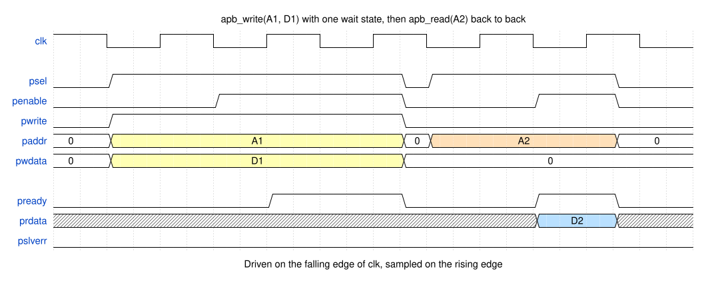
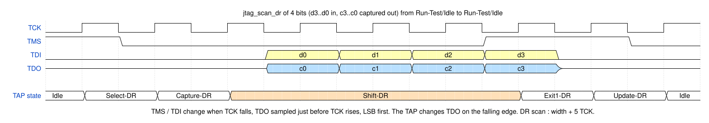

<!--
  README MODEL (adapted for a verification library: no RTL)
  ----------------------------------------------------------
  Regenerate from the sources, never from the previous README text alone:
    src_bfm/*.vhd (records, procedures), uvvm.core (VLNV, targets, depends),
    mk/targets.txt, sim/.
  Sections, in this order:
    badges / title + one-line pitch / Overview / BFMs / one section per BFM
    (procedures, configuration, usage, timing) / OpenOCD co-simulation kit
    (openocd.core, src_openocd/) / Design Verification /
    Repository Layout / License
  Rules:
    - English, short and factual: every statement backed by the sources.
    - No VLNV line: the version badge shows it.
    - Badges: first line version, license; second line CI, sim (no lint, no syn: no RTL).
    - Timing diagrams: WaveDrom source doc/uvvm-<what>.json, rendered
      doc/uvvm-<what>.svg (make -C doc), shown as images.
-->
[](https://github.com/deuskane/asylum-verification-uvvm/tags)
[](LICENSE)

[](https://github.com/deuskane/asylum-verification-uvvm/actions/workflows/ci.yml)
[](https://github.com/deuskane/asylum-verification-uvvm/actions/workflows/ci.yml)

# Asylum UVVM BFMs

**Small, readable UVVM bus functional models for the protocols UVVM does not cover: an APB3 master, an IEEE 1149.1 JTAG master and an OpenOCD remote_bitbang master, each verified against a testbench model; and the kit that connects OpenOCD to a GHDL simulation.**

Part of the [Asylum project](https://github.com/deuskane/asylum-project), a collection of small IP cores, written to be read and learned from.

## Table of Contents

1. [Overview](#overview)
2. [BFMs](#bfms)
3. [APB BFM](#apb-bfm)
4. [JTAG BFM](#jtag-bfm)
5. [remote_bitbang BFM](#remote_bitbang-bfm)
6. [OpenOCD co-simulation kit](#openocd-co-simulation-kit)
7. [Design Verification](#design-verification)
8. [Repository Layout](#repository-layout)
9. [License](#license)

## Overview

The Asylum testbenches are written with [UVVM](https://github.com/UVVM/UVVM) (utility library and BFMs). UVVM has no APB, no JTAG and no OpenOCD remote_bitbang VIP, so the Asylum IPs that need them share the BFMs of this library instead of keeping their own copies. For the same reason, the OpenOCD co-simulation kit (a TCP server of the OpenOCD remote_bitbang adapter, its GHDL binding and the hooks of the co-simulation targets) lives here once, in a second small core.

The library has the form of UVVM Light:

- one FuseSoC core, `asylum:verification:uvvm`, which depends on `bitvis:verification:uvvm` (`uvvm_util`),
- one VHDL library, `asylum_uvvm`,
- one package per BFM in `src_bfm/<name>_bfm_pkg.vhd`, BFMs only (no VVC).

Each BFM follows the conventions of the UVVM BFMs: an interface record (`t_<name>_if`) with an `init_<name>_if_signals` function (outputs inactive, inputs at `'Z'`), a configuration record (`t_<name>_bfm_config`) with a default constant, procedures with `msg`, `scope`, `msg_id_panel` and `config` parameters, logs and alerts of `uvvm_util`.

Use it in a core:

```yaml
    depend :
      - asylum:verification:uvvm
```

The co-simulation kit is the core `asylum:verification:openocd` (`openocd.core`, no dependency), see [OpenOCD co-simulation kit](#openocd-co-simulation-kit).

The cores of the Asylum IPs are published in the FuseSoC library [asylum-cores](https://github.com/deuskane/asylum-cores), with the UVVM cores.

## BFMs

| BFM | Package | Protocol | Procedures |
|-----|---------|----------|------------|
| APB  | `asylum_uvvm.apb_bfm_pkg`  | AMBA APB3 master, synchronous to the bus clock | `apb_write`, `apb_read`, `apb_check` |
| JTAG | `asylum_uvvm.jtag_bfm_pkg` | IEEE 1149.1 master, drives TCK itself | `jtag_trst`, `jtag_reset`, `jtag_idle`, `jtag_write_ir`, `jtag_scan_dr`, `jtag_check_dr`; monitor `jtag_ir_capture_monitor` |
| remote_bitbang | `asylum_uvvm.rbb_bfm_pkg` | The bytes OpenOCD sends to a remote_bitbang JTAG master, on an AXI-Stream or a UART line | `rbb_command`, `rbb_read`, `rbb_tms`, `rbb_reset`, `rbb_idle`, `rbb_write_ir`, `rbb_scan_dr`, `rbb_check_dr`; monitors `rbb_axis_monitor`, `rbb_uart_monitor` |

## APB BFM

### Interface and configuration

`t_apb_if`: `psel`, `penable`, `pwrite`, `paddr` (unsigned), `pwdata` (to the DUT), `prdata`, `pready`, `pslverr` (from the DUT). `paddr`, `pwdata` and `prdata` are unconstrained: constrain them in the signal declaration and initialize the signal with `init_apb_if_signals(addr_width, data_width)`.

| Field of `t_apb_bfm_config` | Default | Description |
|-----------------------------|---------|-------------|
| `max_wait_cycles`          | 10            | Maximum number of cycles with `pready` low in the access phase |
| `max_wait_cycles_severity` | `failure`     | Severity of the timeout |
| `expected_pslverr`         | `'0'`         | Value of `pslverr` expected at the end of the transfer |
| `pslverr_severity`         | `error`       | Severity of a `pslverr` mismatch |
| `match_strictness`         | `MATCH_EXACT` | Matching of std_logic values in `apb_check` |
| `id_for_bfm`               | `ID_BFM`      | Message ID of the logs |
| `id_for_bfm_wait`          | `ID_BFM_WAIT` | Message ID of the wait for `pready` |

### Procedures

| Procedure | Parameters | Description |
|-----------|------------|-------------|
| `apb_write` | `addr_value, data_value, msg, clk, apb_if [, scope, msg_id_panel, config]` | One write transfer. `data_value` may be narrower than `pwdata` (zero extended) |
| `apb_read`  | `addr_value, data_value (out), msg, clk, apb_if [, scope, msg_id_panel, config]` | One read transfer, returns `prdata` |
| `apb_check` | `addr_value, data_exp, msg, clk, apb_if [, alert_level, scope, msg_id_panel, config]` | Read, then compare with `data_exp` (`'-'`: don't care bit); `=> OK` log or alert of `alert_level` |

### Usage

```vhdl
library asylum_uvvm;
use     asylum_uvvm.apb_bfm_pkg.all;

  signal apb_if : t_apb_if(paddr (8-1  downto 0),
                           pwdata(32-1 downto 0),
                           prdata(32-1 downto 0)) := init_apb_if_signals(8, 32);

  -- In the sequencer
  apb_write(x"10", x"5A3C96E1", "Write CTRL", clk, apb_if);
  apb_check(x"10", x"5A3C96E1", "Read back CTRL", clk, apb_if);
```

Connect `apb_if.psel`, `apb_if.penable`, ... to the DUT, and drive `apb_if.prdata`, `apb_if.pready` and `apb_if.pslverr` from the DUT outputs with concurrent assignments.

### Timing



The BFM drives the bus on the falling edge of `clk` and samples it on the rising edge (`SYNC_ON_CLOCK_ONLY` of UVVM). A transfer is a setup phase of one cycle (`psel`), then an access phase (`psel`, `penable`) until `pready`; `pslverr` is checked at the end of the transfer. The procedure returns a quarter of a period after the rising edge that ends the transfer: the next call starts a setup phase on the following falling edge, so two calls are back to back (2 cycles per transfer without wait state; `psel` falls for a quarter of a period between them, never on a rising edge).

## JTAG BFM

### Interface and configuration

`t_jtag_if`: `tck`, `tms`, `tdi`, `trst_b` (to the DUT), `tdo` (from the DUT). `init_jtag_if_signals` returns TCK low, TMS high, TDI low, TRST* inactive and TDO at `'Z'`.

| Field of `t_jtag_bfm_config` | Default | Description |
|------------------------------|---------|-------------|
| `tck_period`       | 100 ns        | Period of TCK, generated by the BFM |
| `ir_width`         | 5             | Width of the instruction register (>= 2) |
| `idle_cycles`      | 0             | Extra Run-Test/Idle cycles at the end of each scan |
| `trst_enable`      | true          | The DUT has TRST*: `jtag_reset` pulses `trst_b` before the TMS sequence, `jtag_trst` is allowed (`TB_ERROR` otherwise) |
| `head_ir`          | 0             | Chain: IR bits of the TAPs between the target and TDO, shifted first (ones: BYPASS) |
| `tail_ir`          | 0             | Chain: IR bits of the TAPs between TDI and the target, shifted last (ones: BYPASS) |
| `head_dr`          | 0             | Chain: number of TAPs between the target and TDO, one BYPASS bit each, shifted first (zeros) |
| `tail_dr`          | 0             | Chain: number of TAPs between TDI and the target, one BYPASS bit each, shifted last (zeros) |
| `match_strictness` | `MATCH_EXACT` | Matching of std_logic values in `jtag_check_dr` |
| `id_for_bfm`       | `ID_BFM`      | Message ID of the logs |

Build a configuration from `C_JTAG_BFM_CONFIG_DEFAULT` and change the fields you need: a full aggregate must name every field, so it has to change when a field is added. New fields always get a default value that keeps the previous behaviour, and adding one is a MINOR version change: code built from the default constant keeps compiling and behaves the same. In a package, declare the configuration as a deferred constant and compute it in the package body with a small function that starts from `C_JTAG_BFM_CONFIG_DEFAULT` (example: `WardRV_vips` of asylum-processor-WardRV).

### Procedures

| Procedure | Parameters | TCK cycles | Description |
|-----------|------------|------------|-------------|
| `jtag_trst`     | `msg, jtag_if [, scope, msg_id_panel, config]` | 0 (2 periods) | TRST* pulse alone: TCK low, TMS = 1, `trst_b` low during one period, then one period of recovery; the TAP is in Test-Logic-Reset. `TB_ERROR` (and no pulse) when `trst_enable` is false |
| `jtag_reset`    | `msg, jtag_if [, scope, msg_id_panel, config]` | 6 (+ 2 periods with TRST*) | Optional TRST* pulse (`jtag_trst`), 5 TCK with TMS = 1 (Test-Logic-Reset from any state), then Run-Test/Idle |
| `jtag_idle`     | `num_cycles, msg, jtag_if [, scope, msg_id_panel, config]` | `num_cycles` | TCK cycles in Run-Test/Idle |
| `jtag_write_ir` | `ir_value, msg, jtag_if [, scope, msg_id_panel, config]` | `head_ir` + `ir_width` + `tail_ir` + 6 + `idle_cycles` | IR scan; checks that the two LSB captured in Capture-IR by the target are `"01"` (IEEE 1149.1) |
| `jtag_scan_dr`  | `data_value, data_out (out), msg, jtag_if [, scope, msg_id_panel, config]` | `head_dr` + width + `tail_dr` + 5 + `idle_cycles` | DR scan of `data_value'length` bits of the target, returns the value it captured |
| `jtag_check_dr` | `data_value, data_exp, msg, jtag_if [, alert_level, scope, msg_id_panel, config]` | `head_dr` + width + `tail_dr` + 5 + `idle_cycles` | DR scan, then compare the value captured by the target with `data_exp` (`'-'`: don't care bit) |

Call `jtag_reset` first: the scans start and end in Run-Test/Idle. After `jtag_trst` the TAP is in Test-Logic-Reset: one `jtag_idle` cycle moves it to Run-Test/Idle.

### Chain of TAPs

The BFM scans one target TAP at a time; the other TAPs of the chain stay in BYPASS. `head_ir`, `tail_ir`, `head_dr` and `tail_dr` have the meaning of `HIR`, `TIR`, `HDR` and `TDR` in SVF (the format of OpenOCD `svf` and of the vendor tools):

- the **head** is the TDO side: the TAPs between the target and TDO. Their bits are shifted first (LSB of the scan), and they are the first ones out of TDO;
- the **tail** is the TDI side: the TAPs between TDI and the target. Their bits are shifted last.

```
        tail (TDI side)                        head (TDO side)
TDI --> [ TAP ] --> [ TAP ] --> [ target ] --> [ TAP ] --> TDO
         tail_ir = sum of their IR widths       head_ir = sum of their IR widths
         tail_dr = number of TAPs               head_dr = number of TAPs

scan (LSB first):  head bits | target bits | tail bits
```

- `jtag_write_ir` shifts ones in the head and tail IR bits: BYPASS for the other TAPs (never zeros: the all-zero opcode is EXTEST). It checks the `"01"` captured by the target, at its place.
- `jtag_scan_dr` and `jtag_check_dr` shift zeros in the head and tail DR bits (one BYPASS bit per TAP), and return or check the bits of the target only.
- `jtag_reset`, `jtag_trst` and `jtag_idle` do not depend on the chain: every TAP sees the same TMS and TRST*.
- With the four fields at 0 (the default), the scans are those of a single TAP.

Example, the JTAG chain of PicoSoC: `TDI -> user CPU TAP -> supervisor CPU TAP -> injection TAP -> TDO`, 5-bit IR each.

| Target | `head_ir` | `tail_ir` | `head_dr` | `tail_dr` |
|--------|----------:|----------:|----------:|----------:|
| user CPU TAP (TDI side)       | 10 | 0  | 2 | 0 |
| supervisor CPU TAP (middle)   | 5  | 5  | 1 | 1 |
| injection TAP (TDO side)      | 0  | 10 | 0 | 2 |

```vhdl
  variable v_config : t_jtag_bfm_config := C_JTAG_BFM_CONFIG_DEFAULT;

  -- Target : supervisor CPU TAP, one TAP on each side
  v_config.trst_enable := false;
  v_config.head_ir     := 5;    -- injection TAP
  v_config.tail_ir     := 5;    -- user CPU TAP
  v_config.head_dr     := 1;
  v_config.tail_dr     := 1;
  jtag_write_ir("00001", "IDCODE of the supervisor CPU", jtag_if, config => v_config);
  jtag_check_dr(x"00000000", x"10002001", "Read IDCODE", jtag_if, config => v_config);
```

The same scans in SVF: `HIR 5 TDI (1f); TIR 5 TDI (1f); HDR 1 TDI (0); TDR 1 TDI (0); SIR 5 TDI (01); SDR 32 TDI (00000000) TDO (10002001);`.

### Capture-IR monitor

`jtag_ir_capture_monitor(jtag_if [, expected, scope, msg_id_panel, config])` is a concurrent procedure (it never returns), called in the architecture of the testbench next to the DUT. It follows the TAP controller on TMS (and TRST*, which brings it back to Test-Logic-Reset), keeps the bits shifted out of TDO in Shift-IR and, when the IR scan reaches Update-IR, compares them with `expected` (default `"01"`, zero extended to `config.ir_width`: `"0...01"`). One `=> OK` log per IR scan, an alert of severity `error` on a mismatch.

`jtag_write_ir` checks only the two LSB `"01"` that IEEE 1149.1 requires; the monitor checks the whole value that the DUT loads in Capture-IR, for every IR scan of the testbench, whoever drives the bus.

- In a chain, the monitor checks the `config.ir_width` bits that come out of TDO after the first `config.head_ir` bits: the Capture-IR value of the target TAP of its configuration (`tail_ir` is not used). Its configuration is fixed, so it watches one TAP, whatever TAP the BFM scans.
- To check the whole chain, give the monitor a configuration with `ir_width` = the sum of the IR widths and `head_ir` = 0, and `expected` = the Capture-IR values of every TAP, TDO side in the LSB (e.g. `"00001" & "00001" & "00001"` for three 5-bit TAPs).
- A scan longer than `head_ir` + `ir_width` is checked on these bits only; the next bits are the other TAPs or TDI bits shifted through.
- A scan shorter than `head_ir` + `ir_width` fails: the bits that were not shifted out stay `'U'`.
- The check is made at Update-IR, so a scan may go through Pause-IR.

### Usage

```vhdl
library asylum_uvvm;
use     asylum_uvvm.jtag_bfm_pkg.all;

  signal jtag_if : t_jtag_if := init_jtag_if_signals;

  -- In the architecture : full Capture-IR value of each IR scan
  jtag_ir_capture_monitor(jtag_if, "00001");

  -- In the sequencer
  jtag_reset   ("Reset the TAP", jtag_if);
  jtag_write_ir("00001", "IDCODE", jtag_if);
  jtag_check_dr(x"00000000", x"1DEB0001", "Read IDCODE", jtag_if);
  jtag_trst    ("TRST* : IDCODE selected again", jtag_if);
  jtag_idle    (1, "Run-Test/Idle", jtag_if);
```

### Timing



The BFM generates TCK. In each TCK cycle, TCK falls and TMS / TDI change, then TDO is sampled just before TCK rises (the TAP samples TMS and TDI on the rising edge and changes TDO on the falling edge). Vectors are shifted LSB first; the last bit is shifted with TMS = 1 (Exit1). TCK stays high between two procedures.

## remote_bitbang BFM

The testbench plays OpenOCD in front of a DUT that decodes the OpenOCD [remote_bitbang](https://openocd.org/doc/html/Debug-Adapter-Configuration.html) byte stream, a JTAG master such as `jtag_bitbang` of asylum-debug-jtag (JTAG over a UART). The procedures send the bytes that the bitbang driver of OpenOCD 0.12 sends, so a DUT that passes them works with OpenOCD.

| Byte | Command | Built by |
|------|---------|----------|
| `'0'`..`'7'` | write TCK, TMS, TDI = bits 2, 1, 0 | `rbb_write_cmd(tck, tms, tdi)` |
| `'R'` | read TDO: the DUT answers `'0'` or `'1'` | `rbb_read` |
| `'r'`..`'u'` | reset TRST, SRST = bits 1, 0 (1: asserted) | `rbb_reset_cmd(trst, srst)` |
| `'B'` / `'b'` | LED on / off | `rbb_blink_cmd(led)` |

The scans have the meaning of the [JTAG BFM](#jtag-bfm) scans and take the same `t_jtag_bfm_config` for the chain: `ir_width`, `head_ir`, `tail_ir`, `head_dr`, `tail_dr` (see [Chain of TAPs](#chain-of-taps)), `idle_cycles`, `trst_enable` (`rbb_reset`) and `match_strictness`; `tck_period` is not used (the DUT makes TCK from the bytes).

### Interface, answers and configuration

`t_rbb_if`: `tdata`, `tvalid` (to the DUT), `tready` (from the DUT): the commands as an AXI-Stream; `tx` (to the DUT): the commands as UART frames. `init_rbb_if_signals` returns no command, `tready` at `'Z'` and the UART line idle.

The answers to `'R'` are collected by a concurrent monitor in a `t_rbb_answers` signal (`cnt`: answers since the start of the simulation; `tdo`: the last `C_RBB_DEPTH` = 1024 answers, the last one in the LSB), which the procedures read. Initialize the signal with `C_RBB_ANSWERS_INIT`. Call one monitor in the architecture of the testbench:

- `rbb_axis_monitor(clk, tdata, tvalid, tready, answers [, scope])`: one answer per rising edge of `clk` with `tvalid` and `tready`;
- `rbb_uart_monitor(rx, stop, answers [, scope, config])`: one answer per UART frame on `rx` (`config.uart_config`) while `stop` is `'0'`; after `stop` falls, it waits for an idle line.

An answer other than `'0'` / `'1'` is an error.

| Field of `t_rbb_bfm_config` | Default | Description |
|-----------------------------|---------|-------------|
| `uart`        | false | false: the commands on the AXI-Stream of `rbb_if` (`clk`); true: UART frames on `rbb_if.tx` |
| `uart_config` | UVVM UART BFM default, 115200 baud, no parity, `id_for_bfm` = `ID_NEVER` | UART frames of the commands and of the answers (`rbb_uart_monitor`) |
| `timeout`     | 1 ms | Maximum wait of `tready` and of the answers to `'R'` |
| `id_for_bfm`  | `ID_BFM` | Message ID of the logs |

`C_RBB_BFM_CONFIG_DEFAULT` is a deferred constant: build a configuration from it in a function, as for the JTAG BFM.

### Procedures

All of them take `msg, clk, rbb_if` and, when they wait for answers, `answers`; then the optional `scope, msg_id_panel, config` and `jtag_config` (`t_jtag_bfm_config`).

| Procedure | Parameters | Bytes | Description |
|-----------|------------|-------|-------------|
| `rbb_command`  | `cmd, msg, clk, rbb_if [, scope, msg_id_panel, config]` | `cmd'length` | Sends the bytes of the string `cmd` (e.g. `rbb_reset_cmd('1', '0') & rbb_blink_cmd('1')`), no wait for the answers |
| `rbb_read`     | `tdo (out), msg, clk, rbb_if, answers [, ...]` | 1 | `'R'`, then waits for its answer; `'X'` and an alert without answer |
| `rbb_tms`      | `tms, msg, clk, rbb_if [, ...]` | 2 per bit + 1 | One TCK cycle per bit of `tms` (left first, TDI = 0), then TCK low (`bitbang_state_move` of OpenOCD) |
| `rbb_reset`    | `msg, clk, rbb_if [, scope, msg_id_panel, config, jtag_config]` | 13 (+ 2 with TRST) | `'t'`, `'r'` when `jtag_config.trst_enable`, then 5 TCK with TMS = 1 and one with TMS = 0: Run-Test/Idle |
| `rbb_idle`     | `num_cycles, msg, clk, rbb_if [, ...]` | 2 per cycle + 1 (none for 0) | TCK cycles in Run-Test/Idle |
| `rbb_write_ir` | `ir_value, msg, clk, rbb_if, answers [, ..., jtag_config]` | 3 per bit (head and tail included) + 14 + 2 per idle cycle | IR scan of the target TAP (ones to the head and tail bits); checks the `"01"` it captured |
| `rbb_scan_dr`  | `data_value, data_out (out), msg, clk, rbb_if, answers [, ..., jtag_config]` | 3 per bit (head and tail included) + 12 + 2 per idle cycle | DR scan of the target TAP (zeros to the head and tail bits), returns the value it captured (`'X'` and an alert when answers are missing) |
| `rbb_check_dr` | `data_value, data_exp, msg, clk, rbb_if, answers [, alert_level, ..., jtag_config]` | as `rbb_scan_dr` | DR scan, then compares with `data_exp` (`'-'`: don't care bit) |

A scan goes from Run-Test/Idle to Run-Test/Idle; for each bit: TCK low with TMS and TDI, `'R'`, TCK high (`bitbang_scan` of OpenOCD), LSB first, the last bit with TMS = 1. On the AXI-Stream, a byte is driven on the falling edge of `clk` and taken on a rising edge with `tready` (one byte per cycle at most; an alert after `config.timeout`). On the UART, the procedure returns after the stop bit of the last byte.

### Usage

```vhdl
library asylum_uvvm;
use     asylum_uvvm.jtag_bfm_pkg.all;
use     asylum_uvvm.rbb_bfm_pkg.all;

  signal rbb_if  : t_rbb_if      := init_rbb_if_signals;
  signal answers : t_rbb_answers := C_RBB_ANSWERS_INIT;

  -- In the architecture : DUT s_axis <- rbb_if, answers of its m_axis
  s_axis_tdata  <= rbb_if.tdata;
  s_axis_tvalid <= rbb_if.tvalid;
  rbb_if.tready <= s_axis_tready;
  rbb_axis_monitor(clk, m_axis_tdata, m_axis_tvalid, m_axis_tready, answers);

  -- In the sequencer
  rbb_reset   ("Reset the TAP", clk, rbb_if);
  rbb_write_ir("00001", "IDCODE", clk, rbb_if, answers);
  rbb_check_dr(x"00000000", x"4A7C0E35", "Read IDCODE", clk, rbb_if, answers);
  rbb_command (rbb_reset_cmd('1', '0'), "TRST asserted", clk, rbb_if);
```

Through a UART (the DUT behind a UART receiver and transmitter): `config.uart` = true and the bit time in `config.uart_config`, `rbb_if.tx` to the RX pin of the DUT, and `rbb_uart_monitor(<TX pin of the DUT>, stop, answers, config => config)` with `stop` = `'0'` while the DUT answers on that pin.

## OpenOCD co-simulation kit

`asylum:verification:openocd` (`openocd.core`, files in `src_openocd/`) connects a real OpenOCD (remote_bitbang adapter, TCP) to a GHDL testbench, so that the JTAG logic of an IP is checked with the debugger that drives it on the board. It has no dependency; the IPs depend on it in the fileset of their co-simulation target. It is tested here by `sim_openocd_pin` and `sim_openocd_byte` ([Design Verification](#design-verification)).

| File | Library / copied to | Role |
|------|---------------------|------|
| `rbb_server.c` | `rbb/rbb_server.c` | TCP server of the remote_bitbang adapter, built as `./librbb.so` and called through GHDL VHPIDIRECT. The first call waits 120 s at most for OpenOCD on 127.0.0.1:`RBB_PORT` (environment, default 9824); no call waits for a command, so the simulation keeps running |
| `rbb_pkg.vhd`  | `asylum_uvvm` | VHPIDIRECT binding. BYTE mode, the DUT decodes the bytes: `rbb_recv` (next byte, `RBB_NONE` = -1: none yet, `RBB_CLOSED` = -2), `rbb_send(c)`. PIN mode, the DUT is a TAP: `rbb_tick(tdo)` decodes the commands up to the next pin change, answers `'R'` with `tdo` and returns the pins (bits `RBB_TCK` 0, `RBB_TMS` 1, `RBB_TDI` 2, `RBB_QUIT` 3, `RBB_TRST` 4, `RBB_SRST` 5; `'B'` / `'b'` ignored) |
| `rbb_axis.vhd` | `asylum_uvvm` | Entity of the BYTE mode: the bytes of OpenOCD on `m_axis`, the answers of the DUT on `s_axis` (always ready), one byte each way per cycle of `clk_i` at most, after the reset; `quit_o` when OpenOCD closes the connection |
| `rbb_jtag.vhd` | `asylum_uvvm` | Entity of the PIN mode: `tck_o`, `tms_o`, `tdi_o`, `trst_b_o`, `srst_b_o`, `tdo_i` (`'0'` / `'L'`: 0, anything else: 1, the pull-up of TDO), `quit_o`. Generic `CLK_DIV`: `rbb_tick` every `CLK_DIV` cycles of `clk_i`, so at least `CLK_DIV` cycles between two pin changes (TCK period >= 2 `CLK_DIV` cycles) |
| `cosim.sh`     | `rbb/cosim.sh` | Hooks of the co-simulation target (below) |

`cosim.sh` (cwd = work root):

- `build` (pre_build): `gcc -shared -fPIC` of `rbb/rbb_server.c` into `./librbb.so`;
- `start <openocd.cfg> [<gdb script>]` (pre_run): in the background, waits for the remote_bitbang port of the simulation, then
  - without a GDB script: `openocd -f <openocd.cfg>`; the .cfg runs the checks, prints `SCENARIO PASS` or `SCENARIO FAIL` and ends with `shutdown` (log `openocd.log`);
  - with a GDB script: OpenOCD with the .cfg (GDB port `GDB_PORT`, 3333, and TCL port `TCL_PORT`, 6666), then `gdb-multiarch -nx -batch -x <gdb script>` (log `gdb.log`), then `shutdown` on the TCL port;
  
  `./cosim.cfg`, `VAR=value` lines written by the testbench, is exported to OpenOCD and GDB. When OpenOCD quits, or is killed (a socket error is a closed connection), the server tells the testbench (`quit_o`, `RBB_CLOSED`), which ends the simulation;
- `check` (post_run): prints the logs, fails unless the last one (`gdb.log`, else `openocd.log`) has the line `COSIM_PASS` (default `SCENARIO PASS`).

Environment: `RBB_PORT`, `GDB_PORT`, `TCL_PORT`, `COSIM_PASS`, `COSIM_TIMEOUT` (1800 s: bound of each wait for a port and of OpenOCD and GDB; OpenOCD and GDB still running at the end are killed). It needs `gcc`, `openocd` and `gdb-multiarch` (with Python), present in the Asylum CI image. Each target runs in its own container in the CI, so every co-simulation uses the same port; two co-simulations on one host need different `RBB_PORT` values (and the same port in their .cfg).

The core of an IP (the .cfg, the GDB script and the testbench stay in the IP):

```yaml
filesets:
  sim_openocd:
    files        :
      - sim/openocd/tb_<ip>_openocd.vhd
      - sim/openocd/<ip>.cfg : {file_type : user, copyto : openocd/<ip>.cfg}
    file_type    : vhdlSource-2008
    depend       :
      - asylum:verification:openocd

targets:
  sim_openocd:
    filesets_append : [sim_openocd]
    toplevel        : tb_<ip>_openocd
    hooks :
      pre_build : [cosim_build]
      pre_run   : [cosim_start]
      post_run  : [cosim_check]

scripts:
  cosim_build : {cmd : [bash, rbb/cosim.sh, build]}
  cosim_start : {cmd : [bash, rbb/cosim.sh, start, openocd/<ip>.cfg]}   # GDB : add openocd/<scenario>.py
  cosim_check : {cmd : [bash, rbb/cosim.sh, check]}
```

The .cfg starts with the adapter lines of the co-simulation; on a board, replace them with the lines of the JTAG probe and keep the TAP and target lines:

```tcl
adapter driver remote_bitbang
remote_bitbang host 127.0.0.1
remote_bitbang port 9824
transport select jtag
```

In the testbench, PIN mode:

```vhdl
  ins_rbb : entity asylum_uvvm.rbb_jtag
    generic map
    (CLK_DIV         => 4
    )
    port map
    (clk_i           => clk
    ,arst_b_i        => arst_b
    ,tck_o           => tck
    ,tms_o           => tms
    ,tdi_o           => tdi
    ,trst_b_o        => trst_b
    ,srst_b_o        => srst_b
    ,tdo_i           => tdo                -- 'Z' / 'H' out of the shifts : 1
    ,quit_o          => quit               -- OpenOCD quit : end of the simulation
    );
```

Pitfall of OpenOCD 0.12: after TRST, OpenOCD assumes BYPASS in every TAP; a `drscan` without a new `irscan` aborts on an assertion. Scan the IR first after `adapter assert trst`.

## Design Verification

One self-checking UVVM testbench per BFM, in `sim/<bfm>/`, against a testbench-only model (no RTL of another IP, so that the IPs can use this library without a dependency loop). Scenarios are chosen at run time with the `TESTS_LIST` generic (one package per scenario, each one after a reset); an empty list only builds and elaborates the testbench.

- `tb_apb`: APB3 slave model `tb_apb_slave` (memory of 256 words, a value derived from the address after the reset, `wait_states` cycles with `pready` low, `pslverr` at one address, `prdata` at `'X'` outside the end of a read) with a protocol checker (setup phase of one cycle, `psel`, `penable`, `paddr`, `pwrite`, `pwdata` held until `pready`).
- `tb_jtag`: IEEE 1149.1 TAP model `tb_jtag_tap` (16-state controller, `IR_WIDTH`-bit IR, IDCODE, BYPASS, a `DR_WIDTH`-bit user data register, TRST* and power-on reset, a wrong Capture-IR value on request) whose state is checked to be Run-Test/Idle after each procedure (Test-Logic-Reset after `jtag_trst`); monitors: TMS / TDI change only while TCK is low, count of the TRST* pulses and of the TCK edges, and `jtag_ir_capture_monitor` of the BFM, which checks every IR scan of every scenario.
- `tb_rbb`: the remote_bitbang BFM drives a testbench-only decoder `tb_rbb_decoder` (the commands of the table above, one per cycle, `s_axis_tready` low while an answer is pending, an error on any other byte; on request, `'R'` not answered or `s_axis_tready` held low) in front of the chain of the three TAP models of `tb_jtag` (pull-up on TDO). In the scenario `uart`, the commands are received from `rbb_if.tx` and the answers sent back with the UVVM UART BFM (16 clock cycles per bit). The state of the TAPs is checked to be Run-Test/Idle after each scan; monitors: TMS / TDI change only while TCK is low, count of the TCK edges and of the TRST* pulses, count of the commands taken by the decoder.
- `tb_openocd` (`sim_openocd_*`): OpenOCD 0.12 runs `sim/openocd/tap.cfg` (IDCODE, three DR scans of the 16-bit user data register, TRST while USER is selected then IDCODE after an IR scan, SRST) on the TAP model of `tb_jtag`, through `rbb_jtag` (`MODE` = `pin`, `CLK_DIV` 4) or through `rbb_axis` and `tb_rbb_decoder` (`MODE` = `byte`). The testbench checks that OpenOCD closed the connection, drove TCK, asserted TRST* and SRST*, that the TRST* pulse reset the TAP (USER instruction before, Test-Logic-Reset and IDCODE after: OpenOCD scans the IR after TRST, so it cannot see it), and in PIN mode that the pins changed 4 cycles apart at least; in BYTE mode that it read TDO and switched the LED on.
- `tb_jtag` with `MODEL` = `chain`: `TDI -> TAP 0 -> TAP 1 -> TAP 2 -> TDO`, IR of 8, 5 and 4 bits, a different IDCODE and user data register width (12, 33, 3 bits) per TAP, pull-ups between the TAPs. The instruction of every TAP is checked after each targeted IR scan (the target holds its opcode, the others BYPASS). Two Capture-IR monitors run in every chain scenario: one on the whole chain (`ir_width` 17, `head_ir` 0), one on TAP 1 at its place (`head_ir` 4).

Expected alerts of the BFM procedures (mismatch, `pslverr`, timeout) are raised with severity `WARNING` and counted with `get_alert_counter`, so that a failing count check (`ERROR`) is never hidden by an expected error. The Capture-IR monitor is concurrent, so its severity cannot change with the scenario: its expected alerts stay `ERROR` (`increment_expected_alerts_and_stop_limit`) and their count is checked with `TB_ERROR`. The same rule, the other way round, for the expected `TB_ERROR` of `jtag_trst` (count checked with `ERROR`).

| Target | Scenario | Checks |
|--------|----------|-------:|
| `sim_apb_reset_values` | Read of the slave memory after the reset (one address per address bit) | 10 |
| `sim_apb_write_read`   | Write then read back, data narrower than `pwdata`, don't care bits, mismatch of `apb_check` | 6 |
| `sim_apb_back_to_back` | 4 writes and 4 reads back to back, 2 cycles per transfer | 6 |
| `sim_apb_wait_states`  | 1, 3 and `max_wait_cycles` wait states, duration of each transfer | 6 |
| `sim_apb_pslverr`      | `pslverr` expected (no alert), not expected and missing (one alert each) | 5 |
| `sim_apb_timeout`      | `max_wait_cycles` + 1 wait states: timeout alert, then a normal transfer | 3 |
| `sim_jtag_reset_trst`  | TRST* pulse then TMS reset, IDCODE selected | 11 |
| `sim_jtag_reset_tms`   | Reset by TMS only (no TRST* pulse), IDCODE selected | 11 |
| `sim_jtag_idcode`      | IDCODE read, don't care bits, mismatch of `jtag_check_dr` | 11 |
| `sim_jtag_bypass`      | BYPASS and an undecoded opcode: one bit delay, capture 0 | 13 |
| `sim_jtag_user_dr`     | 40-bit user data register, IR then DR scans | 17 |
| `sim_jtag_idle`        | Number of TCK cycles of each procedure, `idle_cycles` | 17 |
| `sim_jtag_trst`        | `jtag_trst` alone: 2 periods, one TRST* pulse, no TCK edge, TCK low and TMS = 1, Test-Logic-Reset then IDCODE; `TB_ERROR` and no pulse without TRST* | 16 |
| `sim_jtag_ir_capture`  | Capture-IR monitor: IR scans checked, TRST* in Shift-IR (the monitor restarts from Test-Logic-Reset), IR scan of `ir_width` + 3 bits | 12 |
| `sim_jtag_ir_capture_error` | Capture-IR monitor: wrong captured value (MSB set, LSB `"01"`) and IR scan of `ir_width` - 1 bits, one alert each | 7 |
| `sim_jtag_ir8`         | Every JTAG scenario with an 8-bit IR, a 7-bit user data register and TCK 30 ns | 115 |
| `sim_jtag_chain_idcode`     | Chain: IDCODE of every TAP after the reset in one scan; each TAP as the target: IDCODE written to it alone (the others stay in BYPASS), read with `jtag_check_dr` and `jtag_scan_dr` | 42 |
| `sim_jtag_chain_bypass`     | Chain: every TAP in BYPASS (8 bits delayed by 3); each TAP as the target in BYPASS: 1-bit scan (capture 0), 8-bit scan | 48 |
| `sim_jtag_chain_user_dr`    | Chain: user data register of each TAP written, read back after the scans of the other TAPs, then the whole chain in one scan (every value at its place) | 48 |
| `sim_jtag_chain_ir_capture` | Chain: wrong Capture-IR value of each TAP (alert of the whole chain monitor, and of the TAP 1 monitor for TAP 1 only); `head_ir` one bit too large: alert of `jtag_write_ir` | 22 |
| `sim_rbb_commands` | Bytes of `rbb_write_cmd` (every value of TCK, TMS, TDI), `rbb_reset_cmd` (every value of TRST, SRST), `rbb_blink_cmd`, three commands in one `rbb_command`; commands taken, no answer | 22 |
| `sim_rbb_tms`      | `rbb_tms`, `rbb_reset` without and with TRST*, `rbb_idle` (4 and 0 cycles): state of the TAPs, number of commands and of TCK cycles, TCK low, TRST* pulses | 35 |
| `sim_rbb_read`     | `rbb_read` in Run-Test/Idle (pull-up), then one `rbb_read` per bit of the IDCODE in Shift-DR; one answer per read | 5 |
| `sim_rbb_idcode`   | IDCODE of the whole chain; each TAP as the target (head / tail bits): IDCODE written to it alone, read with `rbb_check_dr` and `rbb_scan_dr`, then the target in BYPASS: 8 bits delayed by the chain (the head bits reach TDO) | 39 |
| `sim_rbb_user_dr`  | User data register of each TAP with 2 idle cycles per scan (number of TCK cycles), then the whole chain in one scan | 31 |
| `sim_rbb_uart`     | The commands and the answers as UART frames: reset, IDCODE of the chain, user data register of TAP 1, `rbb_read`, TRST, SRST, LED | 14 |
| `sim_rbb_errors`   | Mismatch (one alert) and don't care bits of `rbb_check_dr`; `'R'` not answered: alerts of `rbb_read` (`'X'`) and `rbb_scan_dr` (data `'X'`); a command not taken; `head_ir` one bit too large: alert of `rbb_write_ir` | 14 |
| `sim_openocd_pin`  | Co-simulation, PIN mode: `SCENARIO PASS` of OpenOCD (5 checks of `tap.cfg`), and the checks of the testbench | 7 |
| `sim_openocd_byte` | Co-simulation, BYTE mode: `SCENARIO PASS` of OpenOCD (5 checks of `tap.cfg`), and the checks of the testbench | 8 |

Checks: number of `=> OK` lines of the log (for `sim_openocd_*`, those of the testbench; OpenOCD prints one `OK` line per check of `tap.cfg`). `sim_apb`, `sim_jtag`, `sim_jtag_chain` and `sim_rbb` build the testbenches only (5-bit IR, 40-bit user data register, TCK 100 ns for `sim_jtag`; chain of 3 TAPs for `sim_jtag_chain` and `sim_rbb`).

The testbenches were validated with mutants of the BFMs (scratch copies, each scenario run alone): penable never set, pready ignored, pslverr not checked, no setup phase, `apb_check` that never fails, timeout one cycle early, reads sent as writes; TDO sampled after TCK fell again, MSB first, wrong TMS on the path to Shift-DR (two places), IR one bit too long or too short, no TRST* pulse, TRST* never released, reset with 2 TMS = 1 only, `idle_cycles` ignored, `jtag_check_dr` that never fails, TMS / TDI changed with the rising edge; `jtag_trst` with a TCK edge, with TMS = 0, without `TB_ERROR` when `trst_enable` is false; a monitor that never alerts, checks only the two LSB, samples TDO in Capture-IR instead of Shift-IR, ignores TRST* (two ways), keeps the last `ir_width` bits instead of the first ones, or does not clear the captured value at Capture-IR; chain: head and tail swapped (IR, DR), IR padded with zeros, DR padded with ones, head or tail bits not shifted (IR, DR), DR read value not stripped of the head bits, scan one bit short, a monitor that ignores the chain position or uses `tail_ir`; remote_bitbang: a wrong TMS byte (TCK high with TMS 0), the last byte of a TMS move with TCK high, TMS bits right first, the `'R'` of the last bit lost, answers decoded in the wrong order or one bit off, head and tail swapped (IR, DR), IR padded with zeros, DR padded with ones, the last bit without TMS = 1, data MSB first, no wait for the answers, missing answers not detected, `rbb_read` always `'1'`, reset without the final TMS 0 or with 4 TMS = 1, SRST instead of TRST, TRST / SRST or TCK / TDI swapped in the command bytes, LED inverted, `idle_cycles` ignored, UART ignored, `tready` not waited, `tvalid` not cleared, `rbb_check_dr` that never fails, Capture-IR not checked, IR scan through Select-DR only, a deaf AXI-Stream monitor, a UART monitor that drops the answers; kit: `rbb_tick` that returns the byte and `rbb_axis` that calls `rbb_tick` (BYTE and PIN modes swapped), TDO not returned (`rbb_tick`, `rbb_jtag`, `rbb_axis`), TRST not decoded, TRST / SRST swapped in `rbb_jtag`, `CLK_DIV` ignored, TCK / TDI swapped in `rbb_tick`, a byte overwritten while `tready` is low, a TAP model whose TRST* does not reset the instruction. Every one is killed by at least one scenario.

```bash
make sim_jtag_idcode                                   # one target (FuseSoC, GHDL)
make sim_openocd_pin                                   # co-simulation (gcc, openocd)
make nonreg                                            # every sim_* target
fusesoc --cores-root . run --build-root build --no-export --run \
  --target sim_jtag asylum:verification:uvvm --TESTS_LIST=idcode,bypass
```

## Repository Layout

```
uvvm.core               FuseSoC core asylum:verification:uvvm
openocd.core            FuseSoC core asylum:verification:openocd (co-simulation kit)
src_bfm/                BFM packages (library asylum_uvvm)
  apb_bfm_pkg.vhd       APB3 master
  jtag_bfm_pkg.vhd      IEEE 1149.1 JTAG master
  rbb_bfm_pkg.vhd       OpenOCD remote_bitbang master
src_openocd/            co-simulation kit: rbb_server.c, rbb_pkg.vhd, rbb_axis.vhd,
                        rbb_jtag.vhd (library asylum_uvvm), cosim.sh
sim/apb/                tb_apb: APB slave model, helpers, one package per scenario
sim/jtag/               tb_jtag: TAP model, helpers, one package per scenario
sim/rbb/                tb_rbb: remote_bitbang decoder, helpers, one package per scenario
sim/openocd/            tb_openocd and tap.cfg: co-simulation of the kit
doc/                    WaveDrom timing diagrams (make -C doc)
Makefile, mk/           common Makefile of the Asylum IPs, targets list
.github/workflows/      CI: one job per sim_* target (make ci_generate)
```

## License

Apache License 2.0, see [LICENSE](LICENSE).
